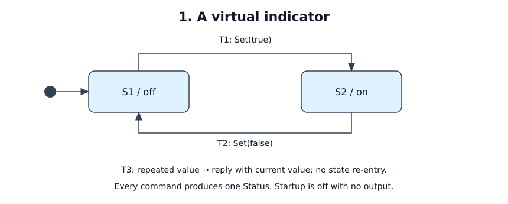

# A virtual indicator

Status: tutorial specification; not implemented. All A-cases below are planned tests.

## Purpose and boundary

Own one logical on/off value for a test client. Topology: one client sends `Set`
to this service and receives `Status`. There is no physical lamp, network,
autonomy, timer or persistent state. The client is the only command authority.

R1: each delivered command produces exactly one status with its request ID and
the resulting value. R2: repeating a desired value does not toggle the indicator.
R3: every fresh process starts off and emits nothing until a command arrives.

## Interfaces and ordering

| ID | Direction / fields | Meaning |
|----|--------------------|---------|
| I1 | in: `Set { request_id: u64, on: bool }` | Set the desired logical value; the ID is echoed, not a deduplication key |
| I2 | out: `Status { request_id: u64, on: bool }` | Command completed in this service's logical state |

The tutorial transport is an in-process request/reply channel with at most one
request in flight. Calls are serialized; the client waits for a response before
the next call. Every delivered retry gets a response, including an identical ID.
Payloads are already typed; wire encoding and malformed-wire handling are N/A.
No freshness, units or coordinate frame apply to a Boolean. Status makes no
claim about physical hardware.

## Behavior

[Editable draw.io source](behavior.drawio)

Legend: filled dot is initial state; arrows labeled T1/T2 change state. Internal
rule T3 is listed in the table and drawing note; it does not re-enter a state.

| State | Meaning | Entry / exit effects |
|-------|---------|----------------------|
| S1 / off | Stored `on = false`; initial state | None |
| S2 / on | Stored `on = true` | None |

| ID | Source | Event / guard | Target | Effects |
|----|--------|---------------|--------|---------|
| T1 | S1 | I1 with `on = true` | S2 | Set value true; emit I2 with request ID and true |
| T2 | S2 | I1 with `on = false` | S1 | Set value false; emit I2 with request ID and false |
| T3 | Either | I1 equals current value | Same, internal | Leave value unchanged; emit I2 with request ID and current value |

All typed commands are accepted. A runtime tick changes nothing and emits nothing.
There are no other events, guards or action priorities.

## Timing, failures and lifecycle

One logical step consumes one command and produces one reply. This example has
no wall-time deadline; deterministic completion within the step is the contract.
No concurrent producer or unbounded request queue is permitted by the harness.
On channel failure, the client reports an incomplete call; no delivery/retry
guarantee is made. The client may restart the service and resend a desired value.
Shutdown emits nothing. Restart clears state to off; requests are not persisted.

## Mapping and replay

One store Boolean, two leaf states, one input payload and one output payload.
T3 is an internal action. The stock adapter can carry these types as newtypes;
call `emit` once per command. Pin the implementation's msrs version at bring-up.
Expose current logical state and command responses. Record startup state,
ordered input triggers and outputs; any idle ticks replay as no-ops.

## Acceptance

| ID / coverage | Given / when | Expected result | Evidence |
|---------------|--------------|-----------------|----------|
| A1 / R1, T1, T2 | Fresh process; `Set(1, true)`, then `Set(2, false)` | Responses `(1, true)`, `(2, false)`; final S1 | Pure-step test |
| A2 / R1, R2, T3 | Fresh process; `Set(1, true)`, `Set(1, true)`, `Set(2, false)` | Exactly three replies: true, true, false with matching IDs | Pure-step test and replay |
| A3 / R3 | Set on, terminate, construct fresh service, then tick | S1; no startup or tick output | Lifecycle test |
| A4 / R1, I1, I2 | Send one request through the loopback transport | Exactly one matching reply; then the next call is permitted | Transport test |

Open decisions: none for the tutorial behavior. Runtime pin and test evidence
remain implementation work. Physical lamp control would require a new contract.
