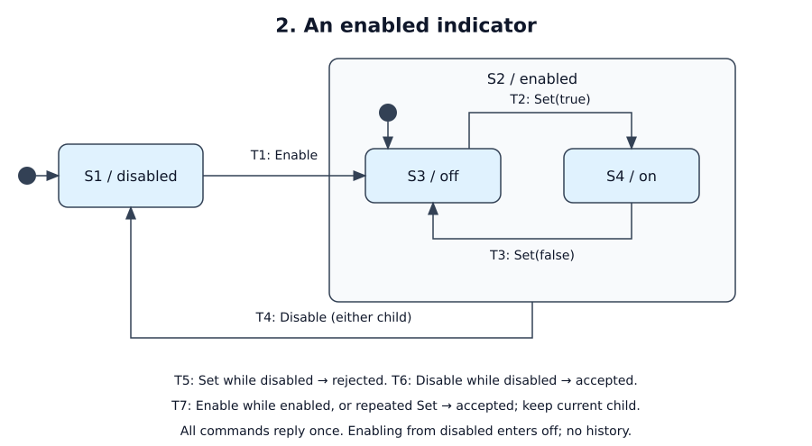

# An enabled virtual indicator

Status: tutorial specification; not implemented. All A-cases below are planned tests.

## Purpose and boundary

Add an enable gate to a logical indicator. One test client owns all commands;
there is no hardware or second authority. Topology: client → service → client.
The indication is meaningful only while enabled. R1: disabled always means
`enabled = false, on = false`. R2: enabling from disabled always starts off.
R3: every command returns exactly one result and the resulting logical state.

## Interfaces and ordering

| ID | Direction / fields | Meaning |
|----|--------------------|---------|
| I1 | in: `Command { request_id: u64, action: Enable / Disable / Set(bool) }` | Requested operation |
| I2 | out: `Result { request_id, outcome: accepted / disabled, enabled: bool, on: bool }` | Logical completion or rejection, plus current state |

The in-process client sends one typed request at a time and waits for its result;
processing follows delivery order. Retries get their own reply, even when IDs
repeat. There is no ID-based deduplication. No timestamps, units or frames apply.
No network decoding is involved. There is no priority reordering between separate
commands: `Disable` followed by `Enable` ends enabled/off. Priorities within a
multi-event batch are N/A because this interface has no batch.

## Behavior

[Editable draw.io source](behavior.drawio)

Legend: the filled dot is the initial leaf. The `enabled` rectangle is a
superstate; its inner initial marker identifies the default entry leaf. T4 leaves
that boundary from either child. T5–T7 are internal rules, noted on the drawing.

| State | Meaning | Entry / exit effects |
|-------|---------|----------------------|
| S1 / disabled | Initial leaf; enabled false, on false | None |
| S2 / enabled | Composite containing S3 or S4; enabled true | None |
| S3 / off | Enabled leaf; on false; default entry to S2 | None |
| S4 / on | Enabled leaf; on true | None |

| ID | Source | Event / guard | Target | Effects before replying |
|----|--------|---------------|--------|-------------------------|
| T1 | S1 | Enable | S3 | Set enabled true, on false; accepted |
| T2 | S3 | Set(true) | S4 | Set on true; accepted |
| T3 | S4 | Set(false) | S3 | Set on false; accepted |
| T4 | S2, either leaf | Disable | S1 | Set enabled false, on false; accepted |
| T5 | S1 | Set(any value) | S1, internal | No mutation; disabled |
| T6 | S1 | Disable | S1, internal | No mutation; accepted |
| T7 | S2, either leaf | Enable, or Set equal to current value | Same leaf, internal | No mutation; accepted |

Every row emits exactly one I2 after its listed effects, with the request ID and
resulting state. No separate entry/exit output is emitted. Ticks do nothing.
Children S3/S4 must defer Disable to S2 without mutation or output; S2 handles
T4. This is a dispatch rule, not a guarantee that queued commands are preempted.

## Timing, failure and restart

One step per command, no wall-time deadline, at most one in-flight request.
No background work or timer is required. Channel failure makes the client's
current call incomplete. Shutdown emits nothing. Cold restart enters S1 with no
output, drops volatile state, and requires a new Enable. No previous child is
restored; re-entry always uses S3. Disabling here concerns a logical indicator;
this example specifies no emergency-stop behavior for a physical robot.

## Mapping, observability and replay

One machine with leaf handlers `disabled`, `off`, `on` and superstate `enabled`.
T1 explicitly targets `State::off()`; there is no transition to a superstate
value. Use a single output containing result and status, so no effect is lost.
Expose state and rejection reason. Record initial state, ordered triggers and
results. The current single-slot adapter suffices; pin its version at bring-up.

## Acceptance

| ID / coverage | Given / when | Expected result | Evidence |
|---------------|--------------|-----------------|----------|
| A1 / R2, T1 | Fresh service; Enable | S3; one accepted result with enabled true, on false | Pure-step test |
| A2 / R1, T4 | Separately start in S3 and S4; Disable | S1 in both cases; exactly one result, both flags false; no intermediate enabled output | Pure-step test per child |
| A3 / R1, T5, T6 | In S1; Set(true), then Disable | First rejected as disabled, second accepted; S1 and flags false throughout | Pure-step test |
| A4 / R2, T1–T4, T7 | Enable, Set(true), Enable, Disable, Enable, Set(true), Set(false), Set(false) | S3, S4, S4, S1, S3, S4, S3, S3; all accepted, one reply each | Pure-step test and replay |
| A5 / R1, R3 | Restart from S4; tick; then send Enable over loopback | Startup S1 with no output; tick no-op; one accepted reply in S3 | Lifecycle/transport test |

Open decisions: none for this tutorial behavior. Runtime pin and test results are
implementation work; multi-authority control would need an additional contract.
