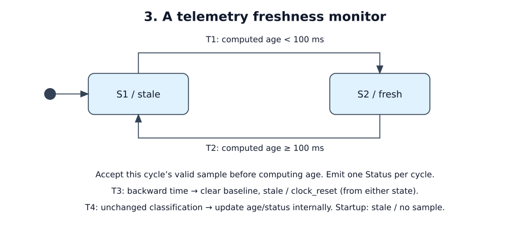

# A telemetry freshness monitor

Status: tutorial specification; implementation requires the timed-cycle producer
described below. Acceptance cases are planned, not passing test results.

## Purpose and boundary

Report whether telemetry from one local sensor is recent. Topology: sensor →
timed-cycle producer → monitor → status consumer. The producer and sensor share
one monotonic clock domain. There are no actuator commands or coordinate frames.
The consumer owns any reaction to stale status or disappearance of this monitor.

R1: fresh means a valid sample exists and its age is strictly less than 100 ms.
R2: each cycle emits exactly one status, even when freshness is unchanged.
R3: a new process starts stale/unknown. R4: sample traffic cannot suppress cycles.

## Interfaces

| ID | Direction / fields | Meaning |
|----|--------------------|---------|
| I1 | in: `Cycle { now_ns: u64, sample: Option<Sample> }` | One scheduled decision instant; sample is optional |
| — | `Sample { seq: u64, acquired_ns: u64 }` | Sensor observation sequence and acquisition time in the same clock domain |
| I2 | out: `Status { freshness: fresh / stale, age_ns: Option<u64>, sample_seq: Option<u64>, reason: recent / expired / no_sample / clock_reset }` | Classification at this cycle's `now_ns` |

Configuration: `max_age_ns = 100_000_000`; nominal cycle period 10 ms, maximum
cycle gap 20 ms; monitor step budget 1 ms from dispatch to emitted status. These
are requirements for the tutorial implementation, not measured capabilities.

## Cycle production, ordering and validation

The sensor sequence increases strictly within a session. The producer retains
the highest-sequence sample received since the previous cycle in a single bounded
slot (older pending samples are coalesced, not queued). It atomically takes that
slot and samples `now_ns` when dispatching a cycle. Arrivals after the take belong
to the next cycle. At most one cycle is in flight; no cycle backlog is allowed.
The producer must continue dispatching under continuous sensor input. Sensor
session changes require a monitor restart; sequence wrap is not supported.

For each cycle, perform these operations in order:

1. If `now_ns` is less than the preceding cycle time, clear the saved sample and
   sequence baseline, discard this cycle's sample, enter stale, and emit I2 with
   both optional fields absent and reason `clock_reset`. Save the new cycle time.
   The next cycle starts a fresh observation session. Equal cycle times are valid.
2. Otherwise accept the attached sample only if `acquired_ns <= now_ns`, its
   sequence exceeds the last accepted sequence, and its acquisition time is not
   less than the last accepted acquisition time. With no saved sample, only the
   future-time check applies. Invalid samples do not replace the saved sample.
3. Compute age from the last accepted sample. No sample means stale with absent
   age/sequence and reason `no_sample`. Age < 100 ms means fresh/recent; age >=
   100 ms means stale/expired. Emit I2 once and save the cycle time.

A newer sample may already be expired and is still accepted. Expired samples are
retained to explain age. Duplicate, out-of-order and future samples cause no
special reply; the normal status uses the retained valid observation. Record
their rejection reason for diagnostics. Record coalescing counts at the producer.

## Behavior

[Editable draw.io source](behavior.drawio)

Legend: initial dot means stale with no sample. T1/T2 are classification changes
after the ordered cycle processing above. T3 is the shared clock-reset rule;
T4 is an internal classification update. Neither is an additional output.

| State | Meaning | Entry / exit effects |
|-------|---------|----------------------|
| S1 / stale | Initial leaf; no valid observation or age >= 100 ms | None |
| S2 / fresh | Saved sample age < 100 ms at the last evaluated cycle | None |

| ID | Source | Condition | Target | Effect |
|----|--------|-----------|--------|--------|
| T1 | S1 | Normal cycle computes fresh | S2 | Emit that cycle's I2 |
| T2 | S2 | Normal cycle computes stale | S1 | Emit that cycle's I2 |
| T3 | Either | Backward cycle time | S1, internal if already stale | Clear baseline; emit clock_reset I2 |
| T4 | Either | Normal cycle keeps classification | Same, internal | Update retained data/age; emit that cycle's I2 |

State describes the last evaluated instant, not a continuously updated physical
fact. A sample arriving in a cycle exactly at the old sample's expiry is applied
first: a new sample acquired at that instant keeps the result fresh. A cycle
without it becomes stale. There is no intermediate stale output in the former case.

## Failure and lifecycle

Sensor loss produces cycles without new samples; the saved sample expires.
Under the stated schedule, stale status is emitted no later than 21 ms after
expiry (20 ms maximum dispatch gap plus 1 ms processing budget). A cycle gap or
step-budget violation is reported by the producer/supervisor as a timing fault;
the monitor cannot enforce its own scheduling guarantee when it is not running.
The supervisor records the violation and restarts the producer/monitor session.

Shutdown emits nothing; abrupt loss of this process produces no final status.
The consumer owns monitoring missing status; its reaction is out of scope here.
Restart clears all state and emits nothing until the first cycle, which may
immediately become fresh if it carries a valid sample. No checkpoint is restored.

## Mapping, observability and replay

Use a single `Cycle` input payload and single `Status` output. The producer is a
required scheduling/ingress component, not a timer inside the store. The stock
msrs adapter supplies Tick only on empty input; it does not create this cycle
contract. Implement and verify the producer and dispatch budget before claiming
R4. Incidental runtime `Tick` triggers are no-ops in this monitor.

Store accepted sequence/time and last cycle time; classify using pure methods.
Record configuration, cold initial state, exact ordered Cycle payloads, incidental
ticks and status outputs. Replay with recorded times, including clock-reset and
invalid-sample traces. Producer scheduling/coalescing requires separate load
tests; replaying its delivered decisions alone does not prove its timing bound.
Expose freshness, age, rejection/coalescing counts and deadline violations.

## Acceptance

All times below are milliseconds; encode them as integer nanoseconds in I1.

| ID / coverage | Given / when | Expected result | Evidence |
|---------------|--------------|-----------------|----------|
| A1 / R1, T1, T2, T4 | Cycle(0, sample seq=1 acquired=0); cycles without samples through 90, then 100 | Fresh at 0 and 90 (ages 0, 90); stale at 100 (age 100), reason expired | Pure-step boundary test and replay |
| A2 / R1, T4 | Same trace, but cycle 100 carries seq=2 acquired=100 | Fresh, age 0; exactly one output, no stale intermediate output | Pure-step ordering test |
| A3 / R1, R2 | After seq=1 acquired=0: cycle 10 duplicate seq=1; cycle 20 seq=2 acquired=30; cycle 30 seq=0 | Each invalid sample ignored; retained seq=1, ages 10, 20, 30; one output per cycle | Pure-step validation test |
| A4 / R3, T3, T4 | Fresh at cycle 50 with seq=1 acquired=50; cycle 40 with any sample; then cycle 50 without sample | Clock reset at 40, absent age/sequence; stale/no_sample at 50 | Pure-step test and replay |
| A5 / R4 | Continuous 1 kHz sensor stream for 10 s while running the 100 Hz cycle producer | Bounded single sample slot; no dispatch gap >20 ms; each step <=1 ms; one output per cycle | Producer/transport load test |
| A6 / R1, R3 | Restart; first cycle has no sample; later accept a sample and disconnect sensor while cycles continue | First status stale/no_sample; later stale/expired emitted within 21 ms after expiry | Lifecycle/transport timing test |

Open implementation work: select/pin runtime, implement the bounded producer,
supervision and complete trace capture, then measure A5/A6. No claimed deadline
is satisfied merely by drawing a timeout transition.
